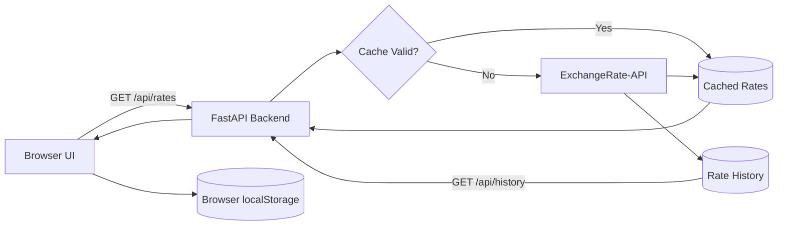

# 💱 Rupee Tracker

<div align="center">

[](https://www.python.org/)
[](https://fastapi.tiangolo.com/)
[](https://developer.mozilla.org/docs/Web/JavaScript)
[](https://www.exchangerate-api.com/)
[](#-license)

### A fast and elegant remittance calculator for converting Pakistani Rupees to and from USD, AED, and SAR.

Live exchange rates, fee-aware calculations, historical rate trends, and a responsive glassmorphism interface.

[Features](#-features) · [Quick Start](#-quick-start) · [API Reference](#-api-reference) · [How It Works](#-how-it-works) · [Roadmap](#-roadmap)

</div>

---

## ✨ Features

| Feature | Description |
|---|---|
| 💱 Live Currency Conversion | Convert between PKR, USD, AED, and SAR |
| 🔁 Currency Swap | Switch conversion direction with one click |
| 💸 Remittance Calculator | Calculate transaction fees and the amount received |
| ⚡ Quick Amounts | Convenient buttons for common PKR amounts |
| 🔤 Amount in Words | Display converted amounts in words |
| 📈 Rate History | View 7–30 day exchange-rate trends |
| 🌗 Light & Dark Themes | Switch between themes |
| 📴 Offline Support | Use previously cached rates when the API is unavailable |
| ⚠️ Stale Rate Warning | Get notified when cached exchange rates are outdated |
| 📱 Responsive Design | Optimized for desktop and mobile screens |
| ♿ Accessibility | Accessible labels, keyboard focus states, and readable contrast |
| 🔐 API Key Protection | Keep the exchange-rate API key on the backend |

---

## 🧱 Tech Stack

| Layer | Technology |
|---|---|
| Backend | Python, FastAPI, Uvicorn |
| Frontend | HTML5, CSS3, Vanilla JavaScript |
| API | [ExchangeRate-API](https://www.exchangerate-api.com/) |
| HTTP Requests | Requests |
| Environment Variables | python-dotenv |
| Storage | JSON files and browser localStorage |

---

## 🚀 Quick Start

### 1. Clone the repository

```bash
git clone https://github.com/muzammilkhaliq7894-ui/Rupee-Tracker.git
cd Rupee-Tracker
```

### 2. Create a virtual environment

**Windows:**

```powershell
python -m venv .venv
.venv\Scripts\activate
```

**macOS / Linux:**

```bash
python3 -m venv .venv
source .venv/bin/activate
```

### 3. Install dependencies

```bash
pip install -r requirements.txt
```

### 4. Configure your API key

Get an API key from [ExchangeRate-API](https://www.exchangerate-api.com/).

Create your local environment file:

**Windows:**

```powershell
copy .env.example .env
```

**macOS / Linux:**

```bash
cp .env.example .env
```

Open `.env` and add your API key using the variable name expected by the backend:

```env
EXCHANGE_API_KEY=your_api_key_here
```

> 🔒 Keep your real `.env` file private. Never commit API keys or other secrets to GitHub.

### 5. Run the application

```bash
uvicorn main:app --reload
```

Open your browser:

**http://127.0.0.1:8000**

---

## 🔌 API Reference

### `GET /api/rates`

Returns the latest available exchange rates.

Example response:

```json
{
  "rates": {
    "PKR": 1,
    "USD": 0.0036,
    "AED": 0.0132,
    "SAR": 0.0135
  },
  "updated": "2026-11-12T00:00:01+00:00",
  "stale": false
}
```

| Field | Description |
|---|---|
| `rates` | Exchange rates relative to one PKR |
| `updated` | Timestamp of the rate update |
| `stale` | Indicates whether cached data is being served because the provider is unavailable |

*The example values are illustrative, not guaranteed live rates.*

### `GET /api/history`

Returns daily exchange-rate snapshots for USD, AED, and SAR, used to display historical trends.

---

## ⚙️ How It Works



### Smart Caching

The backend uses caching to reduce unnecessary API requests and improve reliability.

1. Stores the latest exchange-rate response in memory and `cache.json`.
2. Refreshes rates according to the provider's next-update information, with a fallback refresh interval.
3. Serves cached rates instead of repeatedly requesting the external API.
4. Returns previously cached data with `stale: true` when the provider is unavailable or the API quota is reached.
5. Saves daily exchange-rate snapshots in `history.json`, retaining up to 30 days of history.

---

## 🗂️ Project Structure

```text
Rupee-Tracker/
│
├── static/
│   ├── index.html       # Application interface
│   ├── style.css        # Styling and responsive design
│   └── app.js           # Currency conversion and frontend logic
│
├── main.py              # FastAPI backend and caching logic
├── requirements.txt     # Python dependencies
├── .env.example         # Environment variable template
├── .gitignore           # Git ignored files
└── README.md            # Project documentation
```

---

## 🛣️ Roadmap

- [x] PKR, USD, AED, and SAR conversion
- [x] Remittance fee calculations
- [x] Historical exchange-rate trends
- [x] Offline fallback and stale-rate warning
- [x] Responsive interface
- [ ] Add more currencies (EUR, GBP)
- [ ] Add copy-result functionality
- [ ] Add favourite currency pairs
- [ ] Deploy application to Render or Railway

---

## 🤝 Contributing

Suggestions, bug reports, and contributions are welcome.

For major changes, please open an issue first to discuss what you would like to improve.

---

## 📄 License

This project is released under the MIT License.

---

## 🙏 Credits

Exchange-rate data provided by [ExchangeRate-API](https://www.exchangerate-api.com/).

<div align="center">

**Built by Muzammil**

*Developed with Python, FastAPI, and Vanilla JavaScript.*

⭐ If you find this project useful, consider giving the repository a star!

</div>