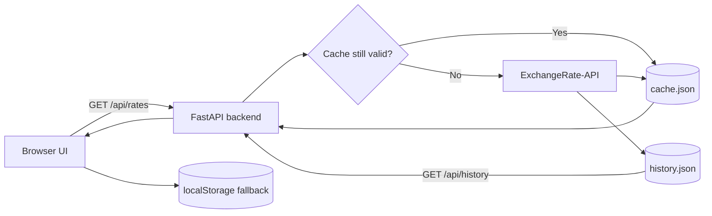

<div align="center">


<br/>

[](https://www.python.org/)
[](https://fastapi.tiangolo.com/)
[](https://developer.mozilla.org/docs/Web/JavaScript)
[](https://www.exchangerate-api.com)
[](#-license)

**A fast, elegant remittance calculator for converting Pakistani Rupees to and from USD, AED and SAR, with live rates, fee-aware results and a clean glassmorphism interface.**

[Features](#-features) · [Quick Start](#-quick-start) · [API](#-api-reference) · [How It Works](#-how-it-works) · [Roadmap](#-roadmap)

</div>

---

## 📸 Preview

<div align="center">


</div>

> Add your own screenshot (or a short demo GIF) at `assets/screenshot.png`.

---

## ✨ Features

| | Feature | Details |
|---|---|---|
| 💱 | **Live conversion** | Results update as you type between PKR, USD, AED and SAR |
| 🔁 | **One-click swap** | Flip the direction with an animated swap button |
| 💸 | **Remittance mode** | Optional fee %, showing what you send and what they receive after the fee |
| ⚡ | **Quick amounts** | One-tap chips for common amounts such as 10k, 50k and 100k PKR |
| 🔤 | **Amount in words** | Reads the amount back in words to avoid typing mistakes |
| 📈 | **Rate sparkline** | 7 to 30 day trend built from daily snapshots |
| 🌗 | **Light and dark themes** | Responsive glassmorphism UI that follows your choice |
| 📴 | **Offline friendly** | Falls back to the last saved rates and warns when they are stale |
| ♿ | **Accessible** | Labelled inputs, visible focus states and readable contrast |
| 🔐 | **Secure by design** | The API key stays on the server and is never sent to the browser |

---

## 🧱 Tech Stack

| Layer | Technology |
|---|---|
| Backend | Python, FastAPI, Uvicorn, `requests`, `python-dotenv` |
| Frontend | HTML5, CSS3 (variables, glassmorphism), vanilla JavaScript |
| Data source | [ExchangeRate-API](https://www.exchangerate-api.com) (free plan) |
| Storage | JSON files (`cache.json`, `history.json`) and browser `localStorage` |

---

## 🚀 Quick Start

### 1. Clone the repository

```bash
git clone https://github.com/YOUR-USERNAME/rupee-tracker.git
cd rupee-tracker
```

### 2. Create a virtual environment

```bash
# Windows
python -m venv .venv
.venv\Scripts\activate

# macOS / Linux
python3 -m venv .venv
source .venv/bin/activate
```

### 3. Install dependencies

```bash
pip install -r requirements.txt
```

### 4. Add your API key

Get a free key at [exchangerate-api.com](https://www.exchangerate-api.com), then:

```bash
# Windows
copy .env.example .env

# macOS / Linux
cp .env.example .env
```

Open `.env` and set:

```env
EXCHANGE_API_KEY=your_api_key_here
```

> 🔒 `.env` is listed in `.gitignore`. Never commit your real key.

### 5. Run the app

```bash
uvicorn main:app --reload
```

Open **http://127.0.0.1:8000** in your browser.

---

## 🔌 API Reference

### `GET /api/rates`

Returns the latest cached PKR rates.

```json
{
  "rates": { "PKR": 1, "USD": 0.0036, "AED": 0.0132, "SAR": 0.0135 },
  "updated": "2026-11-12T00:00:01+00:00",
  "stale": false
}
```

| Field | Meaning |
|---|---|
| `rates` | Units of each currency per 1 PKR |
| `updated` | When the provider last refreshed the rates |
| `stale` | `true` when the provider could not be reached and cached data is served |

### `GET /api/history`

Returns daily USD, AED and SAR snapshots (up to the last 30 days) used for the sparkline.

> The values above are illustrative. Run the app and open `/api/rates` to see your live response.

---

## ⚙️ How It Works



**Smart caching for the free plan.** The free plan updates once a day and allows 1,500 requests per month, so the backend:

1. Keeps the latest response in memory and in `cache.json`.
2. Refreshes only after the provider's `time_next_update_unix` passes (12 hour fallback).
3. Serves every visitor from the cache, so usage does not grow with traffic (roughly 30 requests a month).
4. Returns the last cached data with `stale: true` if the provider fails or the quota is hit.
5. Saves one snapshot per day to `history.json` and keeps 30 days.

---

## 🗂️ Project Structure

```text
rupee-tracker/
├── assets/
│   ├── banner.svg          # Animated README banner
│   └── screenshot.png      # App screenshot
├── static/
│   ├── index.html          # Page layout
│   ├── style.css           # Theme and glassmorphism styles
│   └── app.js              # Conversion logic, UI and sparkline
├── main.py                 # FastAPI backend, caching and history
├── requirements.txt
├── .env.example            # Environment template (no real key)
├── .gitignore
└── README.md
```

---

## 🛣️ Roadmap

- [x] PKR, USD, AED and SAR conversion
- [x] Fee-aware remittance results
- [x] Daily rate history sparkline
- [x] Offline fallback and stale-rate warning
- [ ] More currencies (EUR, GBP)
- [ ] Copy-result button
- [ ] Favourite currency pairs
- [ ] Deploy to Render or Railway

---

## 🤝 Contributing

Suggestions and pull requests are welcome. Please open an issue first to discuss any major change.

---

## 📄 License

Released under the MIT License. Add a `LICENSE` file to the repository to make it official.

---

## 🙏 Credits

Exchange rates provided by [**ExchangeRate-API**](https://www.exchangerate-api.com).

<div align="center">

Built by **Muzammil** with Python and FastAPI

⭐ If you found this useful, consider giving the repo a star.

</div>